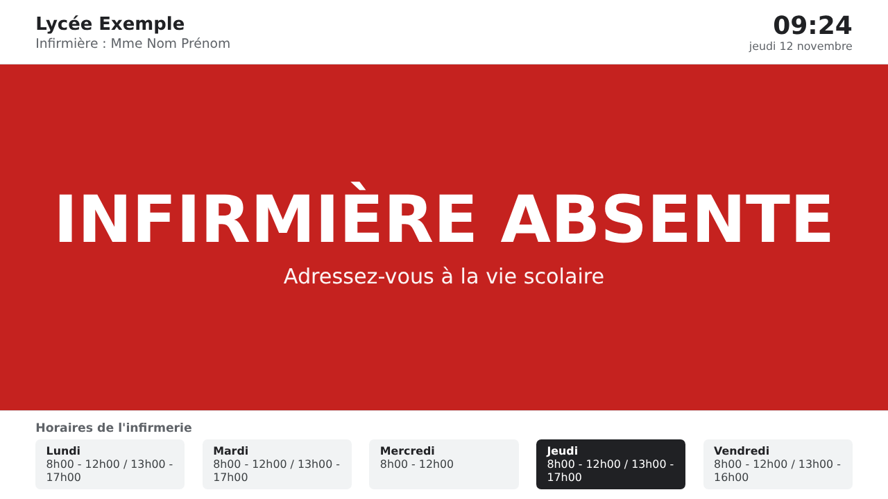

# Affichage infirmerie – version LAN

Affichage de l'état de l'infirmerie d'un lycée sur un Raspberry Pi :

- **Grand écran (HDMI)** : une page plein écran avec l'état (Entrez / Patientez / Absente / Fermé),
  le nom du lycée, le nom de l'infirmière et les horaires (le jour courant est mis en évidence).
- **Petit écran 3,2" sur les GPIO** (Joy-it RB-TFT3.2-V2) : affiche l'état actuel et l'heure.
- **3 boutons physiques** (ceux du petit écran) : état suivant, état précédent, retour à « Entrez ».
- **Réglages** : page web `/reglages` protégée par un code (lycée, infirmière, horaires, code), et
  menu tactile sur le petit écran.

Fonctionne **uniquement sur le réseau local** : pas de compte, pas d'Internet, pas de statistiques.
Le serveur est en Python 3 sans dépendance pour la partie web.




## Démarrage rapide

Sur un Raspberry Pi sous Raspberry Pi OS (Bookworm, bureau), connecté au réseau :

```bash
git clone https://github.com/rubzzz81/affichage-infirmerie-lan.git ~/cabinet-lan
bash ~/cabinet-lan/deploy/install.sh
sync && sudo poweroff        # puis brancher le petit écran et rallumer
```

La page est ensuite sur `http://<ip-du-pi>:8080/` et les réglages sur `http://<ip-du-pi>:8080/reglages`
(code par défaut **1234**, à changer tout de suite).

👉 Le guide pas à pas complet est dans **[docs/INSTALLATION.md](docs/INSTALLATION.md)**.

## Documentation

| Document | Contenu |
|---|---|
| [docs/INSTALLATION.md](docs/INSTALLATION.md) | Installation détaillée, de la carte SD vierge à l'affichage qui fonctionne |
| [docs/MATERIEL.md](docs/MATERIEL.md) | Liste du matériel, branchement de l'écran, broches utilisées |
| [docs/UTILISATION.md](docs/UTILISATION.md) | Utilisation au quotidien : boutons, réglages, changement d'état |
| [docs/DEPANNAGE.md](docs/DEPANNAGE.md) | Problèmes connus et solutions |

## Fichiers

| Fichier | Rôle |
|---|---|
| `config.json` | Réglages : lycée, infirmière, horaires, états, code, boutons, écran |
| `server.py` | Serveur web (réseau local uniquement), état partagé, enregistrement |
| `gpio_panel.py` | Dessin sur le petit écran (framebuffer) et boutons GPIO |
| `ecran_admin.py` | Menu tactile du petit écran (code, clavier, horaires, calibrage) |
| `static/index.html` | Page plein écran |
| `static/reglages.html` | Page de réglages protégée par le code |
| `deploy/install.sh` | Installation automatique |
| `deploy/kiosk.sh` | Lancement de Chromium en plein écran au démarrage |
| `deploy/cabinet-lan.service` | Service systemd (utilisateur) qui lance le serveur |

## Licence

Usage interne à l'établissement.
